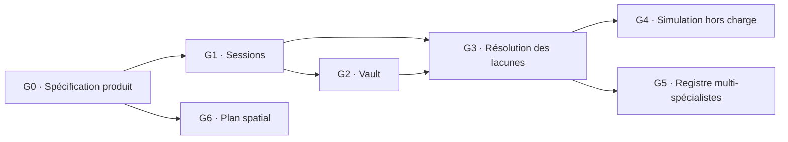

# But produit et feuille de route post-MVP

- **Statut au 19 novembre 2026** — G0 à G11 sont sur `main`. G12 est clôturé sur Windows après qualification de YouTube Analytics en lecture seule sur une chaîne autorisée.
- **Dernière mise à jour** — 2026-11-19.
- **Prérequis** — Phases 0 à 6 qualifiées sur le banc bureau et code.
- **Spec liée** — v0.21, §2, §5.3, §7.3.1, §8 à §11, §13, §14, §17 et §19. [Spécification](../architecture/brain-system-spec.md)

## Ce qui change

Le but produit passe d’un MVP « deux parcours + évolution bornée sur banc » à un agent de demandes utilisateur qui compose des spécialistes, comble les lacunes sous garde-fous, mémorise par session et globalement, simule hors charge, et isole les secrets dans un vault.

La v0.19 a fixé ce but. La v0.20 l’étend aux demandes audio et aux interactions vocales locales. La v0.21 ajoute le contexte web, la lecture HTTPS publique et le cadre cible de connexion aux services tiers. [Plan de développement](development-plan.md)

## Jugement sur la formulation proposée

### Correct et déjà aligné avec la spec

- Plusieurs spécialistes (LLM, outils, OCR, solveurs, modèles non neuronaux) plutôt qu’un seul LLM. Spec §2.1, §7, §8.4.
- Auto-apprentissage à partir d’expériences observées, avec versionnement et rollback. Spec §11.
- Mémoire et réutilisation. Spec §10. Phases 2 et 6 déjà livrées en partie.
- Traitement sécurisé des données sensibles. Spec §10.4, §10.5, §13. Secrets exclus de l’évolution.

### Correct mais trop large tel quel

- Les domaines s’élargissent selon les preuves disponibles et les classes R0–R3. Une lacune ouvre d’abord un diagnostic et une recherche locale. Le planificateur renvoie ensuite un état d’attente, une proposition ou une issue finale selon le §14.
- « Se débrouiller pour construire les éléments » est vrai aux niveaux A–D du §11.2 (recomposer, lier, compétence, adaptateur). Le niveau E (entraîner ou intégrer un modèle) et le niveau F (modèle du monde) exigent preuves, licences et accords. Le MVP interdit déjà qu’un nœud de travail mute le graphe actif ou les permissions.

### Nouveau par rapport au plan 0–6

- Sessions utilisateur avec mémoire de session distincte de la mémoire globale.
- Filtre de persistance des sessions dès G1, puis vault hybride et références par handle en G2.
- Les simulations hors charge de G4 génèrent et évaluent des cas synthétiques Notes. Leurs résultats sont journalisés.

### Oublié dans la formulation (à garder)

- Succès par exécution et vérificateurs, jamais par juge LLM seul.
- Approbation humaine pour projet réel, suppressions, téléchargements.
- Contrats versionnés, traces, promotion par paliers, rollback.
- Budget CPU, RAM, GPU et concurrence. Un rêve ne vole pas une tâche interactive.
- Banc de transfert réservé hors optimisation.
- Plan de recherche spatial distinct (§9, §17).

## Décisions produit (figées 2026-11-17)

1. **Portée des demandes.** Domaines croissants avec abstention honnête.
2. **Unité UX primaire.** Session portant des projets.
3. **Vault.** Hybride. Keystore OS pour les secrets. Vault applicatif pour les métadonnées de handle.
4. **Cible longue.** Agent universel local. Spatial en piste séparée pour l’instant.

## But figé (spec §2.1)

Akasha Brain est un agent local multi-spécialistes. Il décompose une demande de session, la route vers des capacités déclarées et vérifie le résultat dans l’environnement. Une lacune déclenche la recherche d’une reprise admissible. Le système apprend en recomposant et en évaluant des graphes candidats. Il conserve les faits admis de session et la mémoire globale sous leur politique de rétention. Hors charge interactive, il peut simuler des cas synthétiques admissibles. G1 filtre les écritures avant persistance. G2 scelle les secrets dans le keystore OS et les référence par des handles.

## Graphe de dépendances des PR

Le graphe indique les dépendances des livraisons. Les PR soumises à revue opérateur requièrent une relecture humaine avant leur fusion.

G4 et G5 ont avancé en parallèle à partir de G3. G6 dépend uniquement de G0 et suit le calendrier de la recherche spatiale.

## Clôture sur main

Les six jalons ont été fusionnés sur `main`. La dernière validation porte sur `02b0447`. Les révisions et les dates ci-dessous correspondent aux fusions, en heure de Paris.

| Jalon | Date | Fusion sur `main` | Preuve |
| --- | --- | --- | --- |
| G1 — Sessions | 17 novembre 2026 | `8f61606` · [PR #2](https://github.com/azerothl/akasha-brain/pull/2) | [Isolation, redémarrage, sauvegarde et latence](../../bench/results/conversation-sessions-g1-v1.json) |
| G2 — Coffre | 17 novembre 2026 | `fbe8e2e` · [PR #3](https://github.com/azerothl/akasha-brain/pull/3) | [Résolution, refus et effacement](../../bench/results/conversation-vault-g2-v1.json) |
| G3 — Reprise des lacunes | 18 novembre 2026 | `b290c1b` · [PR #4](https://github.com/azerothl/akasha-brain/pull/4) | [Voies A à D, RapidOCR et image MCP](../../bench/results/gap-resolution-g3-v1.json) |
| G4 — Simulation hors charge | 18 novembre 2026 | `ae71510` · [PR #5](https://github.com/azerothl/akasha-brain/pull/5) | [Simulation et préemption](../../bench/results/idle-simulation-g4-v1.json) |
| G5 — Routage des spécialistes | 18 novembre 2026 | `02b0447` · [PR #6](https://github.com/azerothl/akasha-brain/pull/6) | [Routage et rejeux sur Windows et Linux](../../bench/results/specialist-routing-g5-v1.json) |
| G6 — Plan spatial | 17 novembre 2026 | `1eb8cb6` · [PR #1](https://github.com/azerothl/akasha-brain/pull/1) | [Plan de recherche relu](spatial-world-model-plan-v0.md) |

### Non-régression sur main

Les suites `tests` et `contracts` ont été exécutées sous Windows après chaque lot de fusion.

| Lot validé | Révision | Tests réussis | Temps de la suite |
| --- | --- | ---: | ---: |
| G1 et G6 | `1eb8cb6` | 272 | 29,68 s |
| + G2 | `fbe8e2e` | 275 | 26,94 s |
| + G3 | `b290c1b` | 289 | 34,15 s |
| + G4 et G5 | `02b0447` | **297** | **137,49 s** |

## Prochains jalons — Voix locale

G7 s’appuie sur la reprise de capacités de G3 et le registre de G5. La livraison suit l’ordre G7, G8, G9. Les demandes vocales de G9 réutilisent le moteur et les vérifications de G7. [Contrats et qualification](../architecture/brain-system-spec.md#731-transcription-et-synthèse-vocale-locales)

| Jalon | Résultat visible | Critère de sortie |
| --- | --- | --- |
| **G7 — Transcription et analyse d’enregistrements parlés** | Un WAV ou FLAC peut être transcrit dans le bureau et via MCP. Les segments horodatés permettent de résumer une réunion, d’en extraire les décisions et actions ou de retrouver un passage. | Publier la comparaison française sur CPU et qualifier un moteur. Rejouer le parcours à cache vide et après qualification, puis vérifier un cas d’analyse avec renvoi aux passages sources, la reprise après accord, l’isolation du projet et l’annulation. |
| **G8 — Lecture des réponses (clôturé)** | Le bouton **Lire la réponse** lit le texte affiché avec une voix française locale. La lecture peut être arrêtée depuis le bureau. | Qualifier une voix en français et vérifier l’intelligibilité, le délai de lecture, l’arrêt et la libération des ressources. |
| **G9 — Demandes vocales (clôturé)** | L’utilisateur peut dicter une demande avec le bouton micro ou importer un enregistrement comme message vocal. Le texte transcrit s’insère en brouillon modifiable et rejoint la conversation à l’envoi. | Rejouer la même phrase dans un enregistrement à analyser et dans une demande vocale. Vérifier que seul le brouillon envoyé déclenche la planification de la consigne. Couvrir le refus d’accès au micro, l’annulation et le nettoyage de la capture. |

- **ASR.** Comparer VibeVoice-ASR-BitNet via VibeASR.cpp à whisper.cpp sur le même corpus français. Retenir le profil par défaut après le rejeu sur le banc. Évaluer le VibeVoice-ASR complet dans un profil optionnel si les usages réunion ou podcast exigent la séparation des locuteurs et les enregistrements longs. [VibeVoice-ASR-BitNet](https://huggingface.co/microsoft/VibeVoice-ASR-BitNet) · [whisper.cpp](https://github.com/ggml-org/whisper.cpp) · [VibeVoice-ASR](https://huggingface.co/microsoft/VibeVoice-ASR)
- **TTS.** La voix française Vivian de Qwen3-TTS assure la lecture en streaming sur GPU. Piper SIWIS medium assure le repli sur CPU si Vivian est indisponible avant le premier son.

### Clôture G8 sur Windows

Au premier vote, Vivian a été choisie pour les phrases 1 et 3. La phrase 2 a reçu « Aucune » malgré une préférence relative pour Vivian. L’auditeur trouvait la question trop plate et la narration de la phrase 3 surjouée. [Votes originaux](../../bench/results/g8-prosodie-79ee9ff269b9-reponses.json) · [Clé du premier lot](../../bench/results/g8-prosodie-79ee9ff269b9-cle.json)

Au deuxième vote, `reference` et `nuance` étaient ex æquo sur la première phrase. L’auditeur a choisi `reference` pour la question finale de la deuxième et `sobre` pour la narration de la troisième, avec `nuance` jugée proche. Le bouton **Lire la réponse** utilise `reference` par défaut. Un compte rendu ou un autre texte identifié comme narratif reçoit `sobre` uniquement s’il ne contient aucune question. [Votes originaux](../../bench/results/g8-streaming-32d496d848c9-reponses.json) · [Clé du deuxième lot](../../bench/results/g8-streaming-32d496d848c9-cle.json) · [Écoute et mesures du moteur](../../bench/corpora/g8-streaming-v1/README.md)

Sur la RTX 4080 SUPER, le délai du clic au premier son observé au curseur audio Windows a été de 13,91 s à froid et de 0,324 s en médiane sur trois lectures à chaud. **Arrêter** a fermé la sortie en 19 ms, sans écriture audio ultérieure. La lecture suivante a réutilisé le même processus. Avec un budget vidéo nul, le repli Piper SIWIS sur CPU a lu la réponse en français avec un premier son à 20,40 s. Sur le corpus réservé à Piper, les neuf éléments attendus ont été retrouvés. [Essais du bouton](../../bench/results/g8-vivian-desktop-v1.json) · [Corpus réservé de Piper](../../bench/results/g8-siwis-fr-reserve-v1.json)

### Clôture G9 sur Windows

Le bureau a traité « Transcris le fichier silence » comme le contenu d’un document, puis comme message vocal importé et comme dictée. Dans ces deux derniers parcours, Whisper a rempli le brouillon. La conversation et le plan sont restés identiques jusqu’au clic sur **Envoyer**. Après correction, le plan a porté sur `silence.wav`, le fichier choisi dans le brouillon. Le rejeu couvre le refus d’ouverture du micro, l’annulation, l’effacement du tampon et l’isolation du brouillon entre sessions. La dictée automatisée utilise une entrée WinMM simulée. [Rejeu du bureau](../../bench/results/g9-voice-desktop.json) · [Tests de la dictée](../../tests/test_desktop_voice.py)

Sur son micro physique, l’utilisateur a confirmé la transcription de « Camille Martin » et « quinze heures ». Après annulation, le champ est resté vide. Il a trouvé la transcription lente. Un essai de transcription en streaming est prévu lors du peaufinage pour évaluer le délai ressenti.

### Pilote G7 sur CPU Windows

Le pilote local utilise whisper.cpp small pour transcrire un fichier du projet dans la conversation et via MCP. Le second lot contient six extraits français de FLEURS, dont trois avec bruit ajouté, et un témoin de silence. Le pilote a signalé les six segments contenant une erreur de mots et a aussi signalé le seul segment exact. Deux des sept mentions de noms propres ont été correctement transcrites. Le témoin de silence a produit un texte vide. [Comparaison initiale](../../bench/results/g7-asr-fr-cpu-v1.json) · [Lot figé](../../bench/corpora/g7-fr-pilot-v2/manifest.json) · [Rejeu et audit par segment](../../bench/results/g7-whisper-pilot-v2.json)

Le réglage sur 60 nouvelles phrases françaises conserve les seuils du pilote. Sur 45 autres phrases mêlées à des enregistrements réels de pluie, de vagues et de feu, un réglage plus permissif abaisse les fausses alertes de 10 à 7 sur 16 segments exacts. Il laisse passer 10 des 52 segments erronés, contre 5 avec le pilote. Le pilote conserve donc son réglage. [Protocole et sources](../../bench/corpora/g7-alert-v3.md) · [Comparaison par segment](../../bench/results/g7-alert-comparison-v3.json)

Le parcours Windows à cache vide demande un accord par téléchargement et qualifie whisper.cpp small sur un extrait français avant de reprendre la demande. Le bureau et MCP réutilisent la qualification au lancement suivant. Le rejeu couvre le refus, l’annulation et le rejet d’un chemin hors projet. [Rejeu à cache vide](../../bench/results/g7-whisper-cold-cache-v1.json)

Le dernier critère de G7 a été vérifié dans le bureau et via MCP sur la même réunion française scénarisée. Chaque point du résumé, la décision et les deux actions citent le WAV et la plage parlée. Le vendredi proposé reste distinct du lundi retenu. Les invitations sont attribuées à Marie. Pour les badges, la personne qui dit « je » reste à identifier. Le pilote est qualifié pour les enregistrements courts dans les formats annoncés. [Enregistrement](../../bench/corpora/g7-reunion-fr-v1/reunion.wav) · [Référence](../../bench/corpora/g7-reunion-fr-v1/reference.json) · [Rejeu et contrôles des citations](../../bench/results/g7-meeting-v1.json)

Le bureau et MCP partagent désormais une instance de whisper.cpp small sur GPU pour le projet ouvert. Sur la RTX 4080 SUPER, le même WAV bruité de 6,96 s a demandé 43,49 s au premier appel dans le bureau, puis 3,06 s à chaud. Le client MCP a retrouvé la même instance en 2,72 s. Avec un budget vidéo nul, MCP a transcrit le fichier sur CPU en 21,78 s. Les deux chemins utilisent la règle d’alerte du pilote. [Rejeu de la résidence GPU](../../bench/results/g7-resident-gpu-v1.json)

## Clôture G10 sur Windows

Depuis une session sans projet, le bureau a consulté une page HTTPS publique, puis repris son URL à la relance « Que dit cette page ? ». Chaque accord a autorisé une seule lecture. Les deux réponses ont affiché la source et l’heure du relevé. Une nouvelle session a demandé une URL, deux liens ont déclenché une demande de précision et l’annulation a laissé le compteur de lectures inchangé. [Relevé du bureau](../../bench/results/g10-web-desktop-cloture.json)

Les contrôles du lecteur couvrent l’expiration de l’accord après cinq minutes, son usage unique, le refus des destinations privées et des redirections, la limite de taille et l’arrêt du processus après quinze secondes. [Qualification](../../bench/results/g10-web-qualification.md)

## Clôture G11 sur Windows

G11 s’appuie sur le coffre G2, le registre G5 et le parcours HTTPS de G10. La ligne de commande charge un registre d’adaptateurs versionnés et permet de créer, consulter, renouveler, révoquer ou déconnecter une connexion liée à une session. [Contrat de collecte et d’intégration](../architecture/brain-system-spec.md#88-collecte-web-et-connexions-aux-services-tiers)

| Jalon | Résultat visible | Critère de sortie |
| --- | --- | --- |
| **G11 — Cadre de connexion aux services tiers** | Configurer un service déclaré au registre, consulter ses opérations, autoriser une connexion à portée réduite et la révoquer. | Qualifier deux services de test, dont un authentifié. Vérifier les contrôles de schéma, de destination, de portée, d’expiration et d’approbation avant toute écriture. Vérifier que les secrets restent dans le coffre et les composants autorisés et que les réponses portent leur provenance. |

Le scénario de clôture a exercé deux services HTTPS locaux, dont un authentifié avec une clé API conservée dans le Gestionnaire d’identification Windows. Il a vérifié le refus d’une opération hors portée, la validation des schémas, l’expiration et le cloisonnement entre sessions. Le service d’essai a enregistré la publication après l’accord distinct d’écriture. Lors d’une révocation concurrente, il n’a reçu aucune requête. Les résultats indiquent leur provenance et la déconnexion a effacé les clés de test. Le banc a aussi chargé un registre opérateur dans un nouveau processus. [Parcours des connexions](../../bench/results/service-connections-g11.json) · [Journal des fournisseurs](../../bench/results/service-providers-g11.json)

## Clôture G12 — YouTube Analytics en lecture seule

La CLI lie une connexion OAuth Google à une session et à une chaîne déclarée. Elle rapporte les vues et les minutes de visionnage estimées sur 28 jours, avec la couverture des dates et la provenance. Le coffre Windows conserve le jeton de renouvellement. Les tests locaux couvrent le retour OAuth dans le navigateur, la rotation du jeton, le cloisonnement, le refus après révocation et l’effacement du coffre avec un fournisseur simulé. [Configuration et rejeu](../../README.md#consulter-les-statistiques-dune-chaîne-youtube) · [Tests G12](../../tests/test_youtube_analytics.py)

L’essai sur une chaîne autorisée a comparé 28 jours de données de la CLI à un export YouTube Studio. Les vues concordent pour chaque jour et l’écart de durée ne dépasse pas une minute par jour. Google a confirmé la révocation. Le jeton a disparu du coffre Windows et une nouvelle lecture a été refusée. [Relevé anonymisé](../../bench/results/g12-youtube-analytics-cloture.md)

## PR-G0 — But produit dans la spec et le plan

- [x] Dépend de : décisions 1–4 ci-dessus
- [x] Fichiers : `docs/architecture/brain-system-spec.md` (§2.1, §8.5, §8.7, §10.6, §11.8, §14, §17, §19), `docs/plans/development-plan.md` (post-MVP), ce fichier
- [x] Un changement : figer le but produit et retirer l’ambiguïté « n’importe quelle demande »
- [x] Résultat visible : §2.1 et le plan citent sessions, vault handles, lacunes typées, rêve hors charge, multi-spécialistes
- [x] Vérification unit : n/a docs
- [x] Publication du cadrage demandée par l’opérateur et vérifiée dans `main` à la révision `44fa9f4`.
- [x] Vérification perf : n/a

## PR-G1 — Sessions et mémoire de session

- [x] Dépendance G0 et livraison du stockage et de l’interface des sessions. Les sessions se créent, se listent et se rouvrent avec leurs projets autorisés, leurs faits structurés et leur référence facultative à la mémoire globale.
- [x] Admission avant toute écriture durable de session. Le contrôle hors modèle applique un schéma fermé. Le texte libre, les pièces jointes et les valeurs dont l’admissibilité reste indéterminée demeurent volatiles (§10.6).
- [x] Tests de création, d’isolation, de réouverture, d’échéances et de refus d’une écriture hors schéma. Deux sessions ouvertes sur le même projet ont retrouvé leurs propres faits. Le contrôle a trouvé zéro occurrence du secret synthétique et de son empreinte avant et après redémarrage, y compris lors de la restauration de la sauvegarde chiffrée. [Rejeu G1](../../bench/results/conversation-sessions-g1-v1.json)
- [x] Après redémarrage du serveur MCP, `image_start` a attribué un nouvel identifiant et réutilisé la qualification compatible (§8.7). [Rejeu de redémarrage](../../bench/results/gap-resolution-g3-v1.json)
- [x] Ouverture avec deux faits admis mesurée sur 20 paires. La médiane est de 19,738 ms pour une référence de 14,301 ms et un plafond de 28,602 ms, soit le minimum de deux fois la référence et 500 ms.
- [x] Revue de l’interaction et accord de fusion confirmés par l’opérateur dans la conversation.

### Types livrés

- `SessionId`
- `SessionMemoryRecord` (faits de session, filiation, échéance)
- `GlobalMemoryRef` (référence à la mémoire globale par identifiant)

## PR-G2 — Vault et substitution par handle

- [x] Dépendance G1 et livraison du coffre et de son intégration à la conversation. Le keystore Windows scelle le secret admis. Le coffre applicatif conserve les métadonnées du handle. La résolution est autorisée et journalisée.
- [x] Tests de classification, de scellage, de refus, de résolution autorisée et d’effacement. Le rejeu Windows a affiché un handle après saisie, l’a résolu après redémarrage et a vérifié le refus hors session ainsi que l’effacement dans le keystore. Le contrôle des stockages de session, de mémoire globale, d’audit et de sauvegarde a trouvé zéro occurrence du secret synthétique et de son empreinte. [Rejeu G2](../../bench/results/conversation-vault-g2-v1.json)
- [x] Surcoût médian du scellage de 6,422 ms hors accès au keystore pour un plafond de 20 ms, avec une référence d’écriture mémoire de 3,931 ms. Résolution médiane de 22,939 ms.
- [x] Revue et accord de fusion confirmés par l’opérateur dans la conversation.

## PR-G3 — Remplir une lacune sans improvisation

- [x] Dépendances G1 et G2 et livraison du planificateur et de la récupération. Les préconditions et permissions encadrent la recherche locale. La reprise après accord vérifie l’artefact. Les voies A à D ont été rejouées sur leurs cas de référence. La compétence « lire puis comparer » a été consignée au stade candidat. Une proposition E exige un `GapReport` et l’accord correspondant.
- [x] Issues distinctes pour `missing`, `abstain`, la clarification, l’attente d’accord, le refus de permission et la proposition de construction (§11.8 et §14). Les tests couvrent la priorité de la reprise autorisée, l’attente par artefact, l’abstention, les refus R2/R3 et l’intégrité du graphe actif.
- [x] Rejeux de la demande couverte, de RapidOCR avec qualification en cache, du selfie à cache vide avec deux accords simulés et du PDF sans candidat. La lecture RapidOCR a pris 119,363 s en incluant la qualification et 63,378 s en réutilisant le cache. [Rejeu G3](../../bench/results/gap-resolution-g3-v1.json)
- [x] Cas PDF `missing` en 3,192 ms de médiane hors chargement du modèle, pour un plafond de 2 s. La référence de planification `project.inspect` est de 0,116 ms.
- [x] Revue et accord de fusion confirmés par l’opérateur dans la conversation.

G3 réutilise `GapReport`, la récupération OCR et image et les niveaux d’évolution du §11.2. Le selfie à cache vide fournit la preuve de référence pour les accords et la reprise avec le même `task_id`. [Relevé MCP à cache vide](../../bench/results/image-mcp-cold-cache-v1.json)

## PR-G4 — Rêve hors charge (simulation synthétique)

- [x] Dépendance G3 et livraison de la simulation activable avec `--idle-simulations`. L’admission vérifie les budgets CPU et RAM. La file donne la priorité aux tâches interactives au prochain point sûr.
- [x] Tests d’admission, de préemption et d’exclusion du transfert réservé. Le rejeu a journalisé 16 cas synthétiques, avec 10 réussites pour la référence et 12 pour le candidat.
- [x] Dans Windows Sandbox, la simulation a cédé au lancement de Notes. Les deux exécutions du parcours fixe ont passé les quatre tests et SQLite. Le surcoût au p95 de l’ordonnanceur était de 1,416 ms pour un plafond de 3 s. [Rejeu G4](../../bench/results/idle-simulation-g4-v1.json)
- [x] Sur l’assemblage G4–G5, les deux exécutions Notes avec Rbitnet CPU et RapidOCR ont produit le même premier diff vérifié et les mêmes verdicts après relance. Temps total de 145,024 s en référence et de 145,896 s avec préemption. Sur 20 mesures de l’ordonnanceur, surcoût de 2,09 ms au p95. [Rejeu apparié G4–G5](../../bench/results/specialist-routing-g5-v1.json)
- [x] Fusion autorisée par l’opérateur après la validation de G3.

## PR-G5 — Registre multi-spécialistes explicite

- [x] Dépendance G3 et livraison du registre par modalité, moteur, contrat et budget. Les tests couvrent l’admissibilité et le refus hors contrat. Une éventuelle voie généraliste exige un secours déclaré et autorisé. [Registre](../../akasha_brain/specialists.json)
- [x] Traces distinctes pour RapidOCR et SD-Turbo. Le rejeu image a sélectionné SD-Turbo et le parcours Notes a identifié séparément le spécialiste de code, la vérification SQLite et RapidOCR. Le solveur fixe a vérifié la copie dans le bac avec une réservation modèle de 0 Mio.
- [x] Reprise image à froid avec les artefacts vérifiés et une qualification à effectuer. De `image_resume` au PNG reçu et vérifié par SHA-256, Windows Sandbox a pris 113,521 s pour une référence de 95,664 s et un plafond de 114,797 s. Ubuntu WSL2 a pris 56,944 s pour une référence de 57,611 s et un plafond de 69,133 s. Les plafonds correspondent à 1,2 fois la référence. Le parcours complet avec accords est consigné séparément dans `client_end_to_end_s`. [Rejeux G5](../../bench/results/specialist-routing-g5-v1.json) · [Référence à cache vide](../../bench/results/image-mcp-cold-cache-v1.json)
- [x] Fusion autorisée par l’opérateur après la validation de G3.

## PR-G6 — Plan de recherche spatial

- [x] Dépendance G0 et livraison du plan de recherche. Le document fixe les critères d’entrée depuis le banc bureau et code, cinq cas, le simulateur de référence, les observations, les métriques et les seuils. [Plan spatial](spatial-world-model-plan-v0.md)
- [x] Validation documentaire par relecture opérateur. Après les fusions de G1 et G6, les suites `tests` et `contracts` ont passé 272 tests.

## Ordre d’atterrissage suivi

La chaîne produit a suivi G0, G1, G2, G3, G4 puis G5. G6 a été intégré entre G1 et G2 sur la piste spatiale.

La revue opérateur s’appliquait à G0, G1, G2, G3 et G6, ainsi qu’à G4 si le contrôle de la simulation changeait dans l’interface. La publication du cadrage G0 et les fusions G1, G2, G3 et G6 ont été autorisées dans la conversation. L’accord pour G4 et G5 était conditionné à la réussite des tests après G3.

## Première comparaison entre simulation et stockage Notes

Sur les huit combinaisons synthétiques de G4, le prédicteur réussit six cas et la référence cinq. Le banc retient donc le prédicteur avant de lancer les essais SQLite. Les deux politiques reçoivent ensuite les mêmes dix-huit objectifs de persistance et de relance, chacun dans une base temporaire distincte. La lecture SQL après fermeture donne quinze réussites au prédicteur et quatorze à la référence. Le seul résultat différent concerne une note neuve à conserver après relance sur le stockage fonctionnel. Le prédicteur la sauvegarde avant de relancer le processus. Les deux politiques échouent sur les trois demandes de sauvegarde neuve avec le stockage défectueux. [Résultats par cas](../../bench/results/idle-notes-persistence-v1.json)

La commande `python -m bench.run_idle_notes_persistence` reproduit la comparaison. Elle utilise les deux politiques existantes et les deux stockages du banc Notes. Les signaux de fenêtre sont synthétiques. Le prochain essai devra figer le choix issu de la simulation avant de le confronter à une tâche indépendante de ces scénarios Notes.

## Transfert du choix de plan sur la rotation d’un PNG

Le 18 novembre 2026, les huit simulations Notes ont sélectionné la règle qui privilégie le premier plan dont l’état final prédit satisfait la demande (6 réussites contre 5). La référence prend le premier plan admissible du catalogue ordonné par longueur. Avant l’exécution sur les PNG, le manifeste a figé le choix, les empreintes des sources, les seize couples d’orientations et le critère de gain sans régression. [Manifeste de gel](../../bench/results/idle-rotation-freeze-v1.json)

Chaque bras a reçu la même petite image asymétrique, l’orientation initiale et l’orientation demandée. À la réouverture, le vérificateur a comparé le format, les dimensions et chaque pixel à une matrice attendue dessinée séparément. La règle sélectionnée a réussi 16 cas sur 16 et la référence 8 sur 16. Les huit gains concernent les rotations vers la gauche et les demi-tours. Les deux bras réussissent les quatre copies et les quatre rotations vers la droite. Un second passage a reproduit le rapport à l’octet près. Le rejeu se lance avec `python -m bench.run_idle_rotation_transfer evaluate --output rejeu.json` vers un nouveau fichier, avec Pillow 13.0.0. [Résultats appariés](../../bench/results/idle-rotation-transfer-v1.json)

La comparaison mesure le transfert de la règle de sélection avec un prédicteur géométrique fourni et des orientations connues. Les seize cas couvrent les rotations d’un seul motif. L’apprentissage du prédicteur et le gain sur des demandes utilisateur variées restent à évaluer.

## Apprentissage des transitions sur des PNG

Le banc PNG a ensuite appris l’effet des deux commandes à partir de quatre observations avant/après sur deux images. Pour chaque commande, il cherche la permutation des quatre coins compatible avec toutes les observations. Le choix sur Notes, les permutations apprises et les trois motifs réservés ont été figés avant l’évaluation. [Gel du prédicteur et observations](../../bench/results/learned-rotation-freeze-v1.json)

Sur les 48 demandes réservées (16 couples d’orientations pour chacun des trois motifs), les sorties PNG ont été décodées puis comparées pixel par pixel à une matrice indépendante. Le prédicteur appris obtient 48 réussites, la référence 24 et le témoin aux commandes interverties 24. Un rejeu a reproduit le rapport à l’octet près. Le résultat porte sur des rotations sans perte, des coins distinctifs et un objectif exprimé par les valeurs des quatre coins. Le banc utilise une représentation des coins fournie et fonctionne indépendamment du planificateur interactif. Pour reproduire les deux étapes, exécuter `python -m bench.run_learned_rotation_transfer train` puis `python -m bench.run_learned_rotation_transfer evaluate` avec Pillow 13.0.0. [Rapport par motif et orientation](../../bench/results/learned-rotation-transfer-v1.json)

## Ambiguïté d’orientation sur des PNG aux coins identiques

Le sélecteur gelé a choisi la copie dans les 64 essais (quatre motifs carrés et seize couples d’orientations par motif). Sur la flèche et le point décentré, chacune des deux séries donne 4 copies exactes sur 16. Les copies exactes montent à 8 puis 16 sur les motifs symétriques à 180° et 90°. Le sélecteur retient le premier plan compatible même quand les quatre le sont. Il n’a cherché aucun indice intérieur ni signalé l’ambiguïté.

Une sonde expérimentale conserve les permutations apprises et compte les plans compatibles. Avec un objectif limité aux coins, elle s’abstient 64 fois. Quand la demande inclut une référence visuelle, elle examine des groupes de pixels intérieurs. Elle choisit une orientation unique sur les deux motifs asymétriques (32 PNG exacts après décodage) et s’abstient dans les 32 cas où deux ou quatre rotations restent visuellement équivalentes. Le critère est d’identifier la rotation demandée. Une copie peut donner les bons pixels sans identifier cette rotation. La recherche d’indices intérieurs a été fournie à la sonde et évaluée uniquement sur le banc. Rejeu avec `python -m bench.run_rotation_ambiguity`. [Résultats par motif](../../bench/results/rotation-ambiguity-v1.json)

### Intégration au planificateur de conversation

Le spécialiste local `image.orient` lit les PNG du projet sélectionné. Le plan enregistre les indices demandés, les coins seuls ou la référence visuelle. Si plusieurs rotations correspondent aux coins, la comparaison visuelle départage les candidats à partir du contenu du PNG. Le résultat indique l’angle horaire si une seule rotation convient. Zéro ou plusieurs correspondances produisent une abstention typée. L’aperçu reste en mémoire jusqu’à l’enregistrement demandé par l’utilisateur.

Sur les 64 paires du banc, les demandes avec référence complète ont donné 32 PNG exacts et 32 abstentions sur les motifs symétriques. Les mêmes 64 demandes limitées aux coins ont donné 64 abstentions. Le rejeu vérifie les pixels décodés, les angles compatibles et les fichiers du projet après chaque demande. Commande de rejeu : `python -m bench.run_planner_rotation_ambiguity`. [Comparaison par demande](../../bench/results/planner-rotation-ambiguity-v1.json)

## Ce qui reste non prouvé

- Qu’un vault handle résiste à toutes les fuites (embeddings, backups, exports utilisateur hors Akasha).
- Qu’un rêve synthétique améliore la réussite réelle sans contaminer le transfert.
- Qu’une construction automatique de capacité E soit sûre hors banc.
- Que « toute demande » soit atteignable. La feuille de route assume que ce n’est pas le cas et exige l’abstention.

## Lien avec le travail déjà livré hors phases 0–6

Conserver et nommer comme extensions produit déjà qualifiées :

- conversation Windows et planning d’outils
- MCP Notes, projet, image
- recovery de capacités (OCR)
- résumé de projet / Documentalist

G3 réutilise la récupération des capacités déclarées. G5 réutilise les adaptateurs image et OCR.
