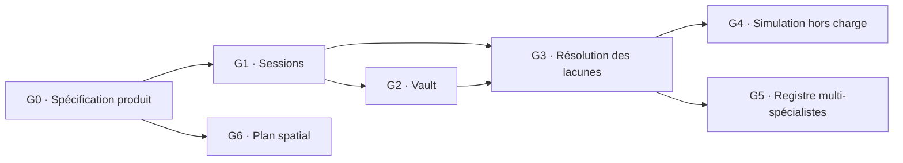

# But produit et feuille de route post-MVP

- **Statut** — Décisions figées, PR-G0 appliquée dans la spec et le plan.
- **Date** — 2026-11-17.
- **Prérequis** — Phases 0 à 6 qualifiées sur le banc bureau et code.
- **Spec liée** — v0.19, §2, §8 à §11, §13, §14, §17 et §19. [Spécification](../architecture/brain-system-spec.md)

## Ce qui change

Le but produit passe d’un MVP « deux parcours + évolution bornée sur banc » à un agent de demandes utilisateur qui compose des spécialistes, comble les lacunes sous garde-fous, mémorise par session et globalement, simule hors charge, et isole les secrets dans un vault.

La spec v0.19 et le plan de développement v0.18 portent ce but. Les PR de code (G1+) attendent un go explicite.

## Jugement sur la formulation proposée

### Correct et déjà aligné avec la spec

- Plusieurs spécialistes (LLM, outils, OCR, solveurs, modèles non neuronaux) plutôt qu’un seul LLM. Spec §2.1, §7, §8.4.
- Auto-apprentissage à partir d’expériences observées, avec versionnement et rollback. Spec §11.
- Mémoire et réutilisation. Spec §10. Phases 2 et 6 déjà livrées en partie.
- Traitement sécurisé des données sensibles. Spec §10.4, §10.5, §13. Secrets exclus de l’évolution.

### Correct mais trop large tel quel

- Les domaines s’élargissent selon les preuves disponibles et les classes R0–R3. Une lacune ouvre d’abord un diagnostic et une recherche locale. Le planificateur renvoie ensuite un état d’attente, une proposition ou une issue finale selon le §14.
- « Se débrouiller pour construire les éléments » est vrai aux niveaux A–D du §11.2 (recomposer, lier, compétence, adaptateur). Le niveau E (entraîner ou intégrer un modèle) et le niveau F (modèle du monde) exigent preuves, licences et accords. Le MVP interdit déjà qu’un nœud de travail mute le graphe actif ou les permissions.

### Nouveau par rapport au plan 0–6

- Sessions utilisateur avec mémoire de session distincte de la mémoire globale.
- Filtre de persistance des sessions dès G1, puis vault hybride et références par handle en G2.
- « Rêver » hors charge pour simuler de nouveaux cas. L’évolution de fond existe déjà. La génération de scénarios synthétiques hors tâche utilisateur n’est pas encore un produit nommé.

### Oublié dans la formulation (à garder)

- Succès par exécution et vérificateurs, jamais par juge LLM seul.
- Approbation humaine pour projet réel, suppressions, téléchargements.
- Contrats versionnés, traces, promotion par paliers, rollback.
- Budget CPU, RAM, GPU et concurrence. Un rêve ne vole pas une tâche interactive.
- Banc de transfert réservé hors optimisation.
- Plan de recherche spatial distinct (§9, §17).

## Décisions produit (figées 2026-11-17)

1. **Portée des demandes.** Domaines croissants avec abstention honnête.
2. **Unité UX primaire.** Session portant des projets.
3. **Vault.** Hybride. Keystore OS pour les secrets. Vault applicatif pour les métadonnées de handle.
4. **Cible longue.** Agent universel local. Spatial en piste séparée pour l’instant.

## But figé (spec §2.1)

Akasha Brain est un agent local multi-spécialistes. Il décompose une demande de session, la route vers des capacités déclarées et vérifie le résultat dans l’environnement. Une lacune déclenche la recherche d’une reprise admissible. Le système apprend en recomposant et en évaluant des graphes candidats. Il conserve les faits admis de session et la mémoire globale sous leur politique de rétention. Hors charge interactive, il peut simuler des cas synthétiques admissibles. G1 filtre les écritures avant persistance. G2 scelle les secrets dans le keystore OS et les référence par des handles.

## Graphe de dépendances des PR

Toutes les PR partent de `main` sauf indication. Les PR marquées revue opérateur bloquent le merge jusqu’à relecture humaine.

PR-G4 et PR-G5 peuvent avancer en parallèle après PR-G3. PR-G6 dépend uniquement de PR-G0 et suit le calendrier de la recherche spatiale.

## PR-G0 — But produit dans la spec et le plan

- [x] Dépend de : décisions 1–4 ci-dessus
- [x] Fichiers : `docs/architecture/brain-system-spec.md` (§2.1, §8.5, §8.7, §10.6, §11.8, §14, §17, §19), `docs/plans/development-plan.md` (post-MVP), ce fichier
- [x] Un changement : figer le but produit et retirer l’ambiguïté « n’importe quelle demande »
- [x] Résultat visible : §2.1 et le plan citent sessions, vault handles, lacunes typées, rêve hors charge, multi-spécialistes
- [x] Vérification unit : n/a docs
- [ ] Vérification live : relecture opérateur des quatre décisions (en attente)
- [x] Vérification perf : n/a
- [ ] Revue opérateur avant merge : oui (en attente)

## PR-G1 — Sessions et mémoire de session

- [ ] Dépend de : PR-G0
- [ ] Fichiers (cible) : nouveaux types sous `akasha_brain/` (session store), `desktop_conversation.py`, contrats éventuels `SessionSpec`, tests dédiés
- [ ] Créer, lister et rouvrir les sessions avec leurs projets autorisés, leurs faits structurés admis et une référence facultative à la mémoire globale.
- [ ] Appliquer l’admission avant toute écriture durable de session. Le contrôle hors modèle accepte un schéma fermé et des valeurs dont l’admissibilité est établie. Le texte libre, les pièces jointes et les valeurs dont l’admissibilité reste indéterminée demeurent volatiles (§10.6 de la spec).
- [ ] Le bouton « Nouvelle session » ouvre un contexte isolé. Au redémarrage, la conversation retrouve ses faits admis et leurs échéances. Après redémarrage du serveur MCP, une tâche image est soumise de nouveau avec `image_start` et reçoit un nouvel identifiant (§8.7 de la spec).
- [ ] Vérifier la création, l’isolation, la réouverture, les échéances et le refus d’une écriture hors schéma ou d’une valeur inadmissible.
- [ ] Ouvrir deux sessions desktop sur le même projet avec des faits distincts. Saisir un secret synthétique, redémarrer et vérifier que chaque session retrouve ses propres faits. Vérifier avant et après redémarrage que le secret et son empreinte sont absents des fichiers de session, des mémoires, des traces, des journaux et des sauvegardes contrôlés.
- [ ] Vérification perf : ouverture d’une session avec N souvenirs. Mesurer d’abord le baseline trunk (latence p50 ouverture conversation). Échec si p50 > 2× baseline ou > 500 ms sur le profil qualifié, le premier seuil atteint
- [ ] Revue opérateur avant merge : oui (interaction)

Types fondateurs à figer avant la logique :

- `SessionId`
- `SessionMemoryRecord` (faits de session, filiation, échéance)
- `GlobalMemoryRef` (référence, pas duplication du contenu sensible)

## PR-G2 — Vault et substitution par handle

- [ ] Dépend de : PR-G1
- [ ] Fichiers (cible) : module vault, `memory_*`, conversation ingest, schémas Retention / consent si besoin, tests de non-fuite
- [ ] Étendre le contrôle d’entrée de G1. Sceller le secret admis dans le keystore OS et conserver les métadonnées de handle dans le vault applicatif. La résolution exige une action autorisée et journalisée.
- [ ] Résultat visible : coller une clé API dans la conversation. La mémoire de session montre un handle. Le fichier mémoire et le journal d’audit ne contiennent ni secret ni empreinte du secret.
- [ ] Vérification unit : classify → seal → resolve refus / resolve ok / erase
- [ ] Vérification live : secret injecté, grep des stores session/global/audit/backup contrôlés = zéro occurrence
- [ ] Vérification perf : seal + resolve p50. Baseline trunk d’un write mémoire. Échec si seal ajoute > 20 ms p50 hors I/O keystore sur le profil qualifié
- [ ] Revue opérateur avant merge : oui

## PR-G3 — Remplir une lacune sans improvisation

- [ ] Dépend de : PR-G1 et PR-G2
- [ ] Fichiers (cible) : `conversation_planning.py`, `capability_recovery.py`, GapReport / évolution existante, registre de capacités
- [ ] Vérifier préconditions et permissions, puis chercher un chemin déclaré et une reprise locale autorisée. Si un prérequis exige un accord, suspendre la tâche dans le parcours prévu et reprendre la demande après vérification de l’artefact. Pour une lacune persistante, évaluer les voies A–D sur un graphe candidat isolé. Une proposition E exige un `GapReport` et l’accord correspondant.
- [ ] Afficher `missing` lorsqu’aucune capacité admissible ne couvre le besoin après diagnostic. Afficher `abstain` lorsque les preuves restent insuffisantes pour agir. Une clarification, une attente d’accord, un refus de permission et une proposition de construction ont leurs issues propres (§11.8 et §14 de la spec).
- [ ] Tester la priorité de la reprise autorisée, l’attente par artefact, l’abstention finale, le refus des actions R2/R3 sans autorisation et l’intégrité du graphe actif.
- [ ] Rejouer une demande couverte, l’OCR avec qualification en cache, le selfie à cache vide avec deux accords et un cas sans candidat qui aboutit à `missing`.
- [ ] Vérification perf : planification d’une demande `missing` < 2 s p50 hors chargement modèle sur profil qualifié. Baseline = `project.inspect` planifié aujourd’hui
- [ ] Revue opérateur avant merge : oui

G3 réutilise `GapReport`, la récupération OCR et image et les niveaux d’évolution du §11.2. Le selfie à cache vide fournit la preuve de référence pour les accords et la reprise avec le même `task_id`. [Relevé MCP à cache vide](../../bench/results/image-mcp-cold-cache-v1.json)

## PR-G4 — Rêve hors charge (simulation synthétique)

- [ ] Dépend de : PR-G3
- [ ] Fichiers (cible) : budgets d’évolution existants, générateur de cas synthétiques, file desktop, tests d’arrêt sous charge interactive
- [ ] Un changement : quand CPU/RAM libres selon budget, lancer des simulations sur banc synthétique admissible. Produire des candidats évalués. Ne pas toucher contenus réels sans accord. Préempter dès tâche utilisateur.
- [ ] Résultat visible : session idle documentée. Au moins un essai synthétique journalisé. Une tâche Notes interactive coupe ou retarde le rêve au prochain point sûr
- [ ] Vérification unit : admission budget, préemption, exclusion transfert réservé
- [ ] Vérification live : idle → un dream run. Puis lancer Notes. Le dream cède. Verdict Notes inchangé sur référence
- [ ] Vérification perf : pendant dream, latence de reprise d’une tâche interactive. Baseline trunk sans dream. Échec si délai au point sûr > 3 s p95 au-delà du baseline
- [ ] Revue opérateur avant merge : non sauf changement UI de contrôle rêve

## PR-G5 — Registre multi-spécialistes explicite

- [ ] Dépend de : PR-G3
- [ ] Fichiers (cible) : `capabilities.json` / manifests, adaptateurs image/OCR/code déjà présents, doc §7
- [ ] Un changement : chaque spécialiste (LLM, OCR, image, SQL, solveur) déclare modality, moteur, contrat, budget. Le routeur ne choisit un LLM généraliste qu’en secours documenté.
- [ ] Résultat visible : une demande image ne charge pas le spécialiste code. Trace montre le nœud choisi et le motif
- [ ] Vérification unit : admissibilité par modality, refus hors contrat
- [ ] Vérification live : une demande OCR et une demande image. Traces distinctes. Pas de chargement croisé inutile
- [ ] Mesurer la reprise à froid du spécialiste image sur le même profil, avec moteur et poids déjà vérifiés et une qualification à effectuer. Chronométrer de `image_resume` au PNG reçu et vérifié par SHA-256. La référence est `client_resume_to_png_s`, soit 95,664 s sous Windows Sandbox et 57,611 s sous Ubuntu WSL2. Un dépassement de 1,2× la référence du profil échoue au contrôle. Le parcours complet avec accords est consigné séparément dans `client_end_to_end_s`. [Relevé de référence](../../bench/results/image-mcp-cold-cache-v1.json)
- [ ] Revue opérateur avant merge : non

## PR-G6 — Plan de recherche spatial

- [ ] Dépend de : PR-G0
- [ ] Fichiers : `docs/plans/spatial-world-model-plan-v0.md` seulement
- [ ] Un changement : plan de recherche avec tâches, simulateur, métriques, seuils. Pas de code produit
- [ ] Résultat visible : document avec critères d’entrée depuis le banc bureau/code
- [ ] Vérification unit : n/a
- [ ] Vérification live : relecture opérateur
- [ ] Vérification perf : n/a
- [ ] Revue opérateur avant merge : oui

## Ordre d’atterrissage

1. PR-G0
2. PR-G1
3. PR-G2
4. PR-G3
5. PR-G4 et PR-G5 en parallèle

PR-G6 peut démarrer dès la clôture de PR-G0, selon le calendrier de la piste spatiale.

Ensemble review-gated : PR-G0, PR-G1, PR-G2, PR-G3, PR-G6.

## Ce qui reste non prouvé

- Qu’un vault handle résiste à toutes les fuites (embeddings, backups, exports utilisateur hors Akasha).
- Qu’un rêve synthétique améliore la réussite réelle sans contaminer le transfert.
- Qu’une construction automatique de capacité E soit sûre hors banc.
- Que « toute demande » soit atteignable. La feuille de route assume que ce n’est pas le cas et exige l’abstention.

## Lien avec le travail déjà livré hors phases 0–6

Conserver et nommer comme extensions produit déjà qualifiées :

- conversation Windows et planning d’outils
- MCP Notes, projet, image
- recovery de capacités (OCR)
- résumé de projet / Documentalist

PR-G3 s’appuie sur recovery. PR-G5 s’appuie sur image et OCR. Ne pas les reconstruire.
