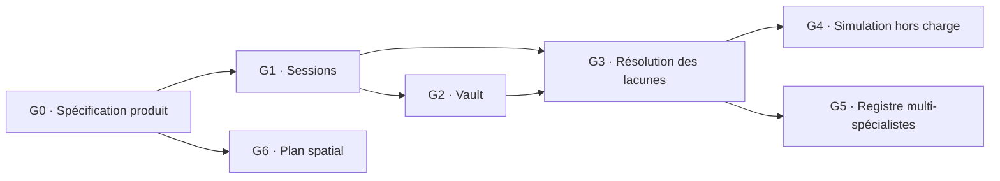

# But produit et feuille de route post-MVP

- **Statut** — G0 publié et G1 à G6 clôturés sur `main`.
- **Dernière mise à jour** — 2026-11-18.
- **Prérequis** — Phases 0 à 6 qualifiées sur le banc bureau et code.
- **Spec liée** — v0.19, §2, §8 à §11, §13, §14, §17 et §19. [Spécification](../architecture/brain-system-spec.md)

## Ce qui change

Le but produit passe d’un MVP « deux parcours + évolution bornée sur banc » à un agent de demandes utilisateur qui compose des spécialistes, comble les lacunes sous garde-fous, mémorise par session et globalement, simule hors charge, et isole les secrets dans un vault.

La spec v0.19 et le plan de développement v0.19 portent ce but. Les révisions fusionnées et leurs résultats figurent dans la section de clôture. [Plan de développement](development-plan.md)

## Jugement sur la formulation proposée

### Correct et déjà aligné avec la spec

- Plusieurs spécialistes (LLM, outils, OCR, solveurs, modèles non neuronaux) plutôt qu’un seul LLM. Spec §2.1, §7, §8.4.
- Auto-apprentissage à partir d’expériences observées, avec versionnement et rollback. Spec §11.
- Mémoire et réutilisation. Spec §10. Phases 2 et 6 déjà livrées en partie.
- Traitement sécurisé des données sensibles. Spec §10.4, §10.5, §13. Secrets exclus de l’évolution.

### Correct mais trop large tel quel

- Les domaines s’élargissent selon les preuves disponibles et les classes R0–R3. Une lacune ouvre d’abord un diagnostic et une recherche locale. Le planificateur renvoie ensuite un état d’attente, une proposition ou une issue finale selon le §14.
- « Se débrouiller pour construire les éléments » est vrai aux niveaux A–D du §11.2 (recomposer, lier, compétence, adaptateur). Le niveau E (entraîner ou intégrer un modèle) et le niveau F (modèle du monde) exigent preuves, licences et accords. Le MVP interdit déjà qu’un nœud de travail mute le graphe actif ou les permissions.

### Nouveau par rapport au plan 0–6

- Sessions utilisateur avec mémoire de session distincte de la mémoire globale.
- Filtre de persistance des sessions dès G1, puis vault hybride et références par handle en G2.
- Les simulations hors charge de G4 génèrent et évaluent des cas synthétiques Notes. Leurs résultats sont journalisés.

### Oublié dans la formulation (à garder)

- Succès par exécution et vérificateurs, jamais par juge LLM seul.
- Approbation humaine pour projet réel, suppressions, téléchargements.
- Contrats versionnés, traces, promotion par paliers, rollback.
- Budget CPU, RAM, GPU et concurrence. Un rêve ne vole pas une tâche interactive.
- Banc de transfert réservé hors optimisation.
- Plan de recherche spatial distinct (§9, §17).

## Décisions produit (figées 2026-11-17)

1. **Portée des demandes.** Domaines croissants avec abstention honnête.
2. **Unité UX primaire.** Session portant des projets.
3. **Vault.** Hybride. Keystore OS pour les secrets. Vault applicatif pour les métadonnées de handle.
4. **Cible longue.** Agent universel local. Spatial en piste séparée pour l’instant.

## But figé (spec §2.1)

Akasha Brain est un agent local multi-spécialistes. Il décompose une demande de session, la route vers des capacités déclarées et vérifie le résultat dans l’environnement. Une lacune déclenche la recherche d’une reprise admissible. Le système apprend en recomposant et en évaluant des graphes candidats. Il conserve les faits admis de session et la mémoire globale sous leur politique de rétention. Hors charge interactive, il peut simuler des cas synthétiques admissibles. G1 filtre les écritures avant persistance. G2 scelle les secrets dans le keystore OS et les référence par des handles.

## Graphe de dépendances des PR

Le graphe indique les dépendances des livraisons. Les PR soumises à revue opérateur requièrent une relecture humaine avant leur fusion.

G4 et G5 ont avancé en parallèle à partir de G3. G6 dépend uniquement de G0 et suit le calendrier de la recherche spatiale.

## Clôture sur main

Les six jalons ont été fusionnés sur `main`. La dernière validation porte sur `02b0447`. Les révisions et les dates ci-dessous correspondent aux fusions, en heure de Paris.

| Jalon | Date | Fusion sur `main` | Preuve |
| --- | --- | --- | --- |
| G1 — Sessions | 17 novembre 2026 | `8f61606` · [PR #2](https://github.com/azerothl/akasha-brain/pull/2) | [Isolation, redémarrage, sauvegarde et latence](../../bench/results/conversation-sessions-g1-v1.json) |
| G2 — Coffre | 17 novembre 2026 | `fbe8e2e` · [PR #3](https://github.com/azerothl/akasha-brain/pull/3) | [Résolution, refus et effacement](../../bench/results/conversation-vault-g2-v1.json) |
| G3 — Reprise des lacunes | 18 novembre 2026 | `b290c1b` · [PR #4](https://github.com/azerothl/akasha-brain/pull/4) | [Voies A à D, RapidOCR et image MCP](../../bench/results/gap-resolution-g3-v1.json) |
| G4 — Simulation hors charge | 18 novembre 2026 | `ae71510` · [PR #5](https://github.com/azerothl/akasha-brain/pull/5) | [Simulation et préemption](../../bench/results/idle-simulation-g4-v1.json) |
| G5 — Routage des spécialistes | 18 novembre 2026 | `02b0447` · [PR #6](https://github.com/azerothl/akasha-brain/pull/6) | [Routage et rejeux sur Windows et Linux](../../bench/results/specialist-routing-g5-v1.json) |
| G6 — Plan spatial | 17 novembre 2026 | `1eb8cb6` · [PR #1](https://github.com/azerothl/akasha-brain/pull/1) | [Plan de recherche relu](spatial-world-model-plan-v0.md) |

### Non-régression sur main

Les suites `tests` et `contracts` ont été exécutées sous Windows après chaque lot de fusion.

| Lot validé | Révision | Tests réussis | Temps de la suite |
| --- | --- | ---: | ---: |
| G1 et G6 | `1eb8cb6` | 272 | 29,68 s |
| + G2 | `fbe8e2e` | 275 | 26,94 s |
| + G3 | `b290c1b` | 289 | 34,15 s |
| + G4 et G5 | `02b0447` | **297** | **137,49 s** |

## PR-G0 — But produit dans la spec et le plan

- [x] Dépend de : décisions 1–4 ci-dessus
- [x] Fichiers : `docs/architecture/brain-system-spec.md` (§2.1, §8.5, §8.7, §10.6, §11.8, §14, §17, §19), `docs/plans/development-plan.md` (post-MVP), ce fichier
- [x] Un changement : figer le but produit et retirer l’ambiguïté « n’importe quelle demande »
- [x] Résultat visible : §2.1 et le plan citent sessions, vault handles, lacunes typées, rêve hors charge, multi-spécialistes
- [x] Vérification unit : n/a docs
- [x] Publication du cadrage demandée par l’opérateur et vérifiée dans `main` à la révision `44fa9f4`.
- [x] Vérification perf : n/a

## PR-G1 — Sessions et mémoire de session

- [x] Dépendance G0 et livraison du stockage et de l’interface des sessions. Les sessions se créent, se listent et se rouvrent avec leurs projets autorisés, leurs faits structurés et leur référence facultative à la mémoire globale.
- [x] Admission avant toute écriture durable de session. Le contrôle hors modèle applique un schéma fermé. Le texte libre, les pièces jointes et les valeurs dont l’admissibilité reste indéterminée demeurent volatiles (§10.6).
- [x] Tests de création, d’isolation, de réouverture, d’échéances et de refus d’une écriture hors schéma. Deux sessions ouvertes sur le même projet ont retrouvé leurs propres faits. Le contrôle a trouvé zéro occurrence du secret synthétique et de son empreinte avant et après redémarrage, y compris lors de la restauration de la sauvegarde chiffrée. [Rejeu G1](../../bench/results/conversation-sessions-g1-v1.json)
- [x] Après redémarrage du serveur MCP, `image_start` a attribué un nouvel identifiant et réutilisé la qualification compatible (§8.7). [Rejeu de redémarrage](../../bench/results/gap-resolution-g3-v1.json)
- [x] Ouverture avec deux faits admis mesurée sur 20 paires. La médiane est de 19,738 ms pour une référence de 14,301 ms et un plafond de 28,602 ms, soit le minimum de deux fois la référence et 500 ms.
- [x] Revue de l’interaction et accord de fusion confirmés par l’opérateur dans la conversation.

### Types livrés

- `SessionId`
- `SessionMemoryRecord` (faits de session, filiation, échéance)
- `GlobalMemoryRef` (référence à la mémoire globale par identifiant)

## PR-G2 — Vault et substitution par handle

- [x] Dépendance G1 et livraison du coffre et de son intégration à la conversation. Le keystore Windows scelle le secret admis. Le coffre applicatif conserve les métadonnées du handle. La résolution est autorisée et journalisée.
- [x] Tests de classification, de scellage, de refus, de résolution autorisée et d’effacement. Le rejeu Windows a affiché un handle après saisie, l’a résolu après redémarrage et a vérifié le refus hors session ainsi que l’effacement dans le keystore. Le contrôle des stockages de session, de mémoire globale, d’audit et de sauvegarde a trouvé zéro occurrence du secret synthétique et de son empreinte. [Rejeu G2](../../bench/results/conversation-vault-g2-v1.json)
- [x] Surcoût médian du scellage de 6,422 ms hors accès au keystore pour un plafond de 20 ms, avec une référence d’écriture mémoire de 3,931 ms. Résolution médiane de 22,939 ms.
- [x] Revue et accord de fusion confirmés par l’opérateur dans la conversation.

## PR-G3 — Remplir une lacune sans improvisation

- [x] Dépendances G1 et G2 et livraison du planificateur et de la récupération. Les préconditions et permissions encadrent la recherche locale. La reprise après accord vérifie l’artefact. Les voies A à D ont été rejouées sur leurs cas de référence. La compétence « lire puis comparer » a été consignée au stade candidat. Une proposition E exige un `GapReport` et l’accord correspondant.
- [x] Issues distinctes pour `missing`, `abstain`, la clarification, l’attente d’accord, le refus de permission et la proposition de construction (§11.8 et §14). Les tests couvrent la priorité de la reprise autorisée, l’attente par artefact, l’abstention, les refus R2/R3 et l’intégrité du graphe actif.
- [x] Rejeux de la demande couverte, de RapidOCR avec qualification en cache, du selfie à cache vide avec deux accords simulés et du PDF sans candidat. La lecture RapidOCR a pris 119,363 s en incluant la qualification et 63,378 s en réutilisant le cache. [Rejeu G3](../../bench/results/gap-resolution-g3-v1.json)
- [x] Cas PDF `missing` en 3,192 ms de médiane hors chargement du modèle, pour un plafond de 2 s. La référence de planification `project.inspect` est de 0,116 ms.
- [x] Revue et accord de fusion confirmés par l’opérateur dans la conversation.

G3 réutilise `GapReport`, la récupération OCR et image et les niveaux d’évolution du §11.2. Le selfie à cache vide fournit la preuve de référence pour les accords et la reprise avec le même `task_id`. [Relevé MCP à cache vide](../../bench/results/image-mcp-cold-cache-v1.json)

## PR-G4 — Rêve hors charge (simulation synthétique)

- [x] Dépendance G3 et livraison de la simulation activable avec `--idle-simulations`. L’admission vérifie les budgets CPU et RAM. La file donne la priorité aux tâches interactives au prochain point sûr.
- [x] Tests d’admission, de préemption et d’exclusion du transfert réservé. Le rejeu a journalisé 16 cas synthétiques, avec 10 réussites pour la référence et 12 pour le candidat.
- [x] Dans Windows Sandbox, la simulation a cédé au lancement de Notes. Les deux exécutions du parcours fixe ont passé les quatre tests et SQLite. Le surcoût au p95 de l’ordonnanceur était de 1,416 ms pour un plafond de 3 s. [Rejeu G4](../../bench/results/idle-simulation-g4-v1.json)
- [x] Sur l’assemblage G4–G5, les deux exécutions Notes avec Rbitnet CPU et RapidOCR ont produit le même premier diff vérifié et les mêmes verdicts après relance. Temps total de 145,024 s en référence et de 145,896 s avec préemption. Sur 20 mesures de l’ordonnanceur, surcoût de 2,09 ms au p95. [Rejeu apparié G4–G5](../../bench/results/specialist-routing-g5-v1.json)
- [x] Fusion autorisée par l’opérateur après la validation de G3.

## PR-G5 — Registre multi-spécialistes explicite

- [x] Dépendance G3 et livraison du registre par modalité, moteur, contrat et budget. Les tests couvrent l’admissibilité et le refus hors contrat. Une éventuelle voie généraliste exige un secours déclaré et autorisé. [Registre](../../akasha_brain/specialists.json)
- [x] Traces distinctes pour RapidOCR et SD-Turbo. Le rejeu image a sélectionné SD-Turbo et le parcours Notes a identifié séparément le spécialiste de code, la vérification SQLite et RapidOCR. Le solveur fixe a vérifié la copie dans le bac avec une réservation modèle de 0 Mio.
- [x] Reprise image à froid avec les artefacts vérifiés et une qualification à effectuer. De `image_resume` au PNG reçu et vérifié par SHA-256, Windows Sandbox a pris 113,521 s pour une référence de 95,664 s et un plafond de 114,797 s. Ubuntu WSL2 a pris 56,944 s pour une référence de 57,611 s et un plafond de 69,133 s. Les plafonds correspondent à 1,2 fois la référence. Le parcours complet avec accords est consigné séparément dans `client_end_to_end_s`. [Rejeux G5](../../bench/results/specialist-routing-g5-v1.json) · [Référence à cache vide](../../bench/results/image-mcp-cold-cache-v1.json)
- [x] Fusion autorisée par l’opérateur après la validation de G3.

## PR-G6 — Plan de recherche spatial

- [x] Dépendance G0 et livraison du plan de recherche. Le document fixe les critères d’entrée depuis le banc bureau et code, cinq cas, le simulateur de référence, les observations, les métriques et les seuils. [Plan spatial](spatial-world-model-plan-v0.md)
- [x] Validation documentaire par relecture opérateur. Après les fusions de G1 et G6, les suites `tests` et `contracts` ont passé 272 tests.

## Ordre d’atterrissage suivi

La chaîne produit a suivi G0, G1, G2, G3, G4 puis G5. G6 a été intégré entre G1 et G2 sur la piste spatiale.

La revue opérateur s’appliquait à G0, G1, G2, G3 et G6, ainsi qu’à G4 si le contrôle de la simulation changeait dans l’interface. La publication du cadrage G0 et les fusions G1, G2, G3 et G6 ont été autorisées dans la conversation. L’accord pour G4 et G5 était conditionné à la réussite des tests après G3.

## Ce qui reste non prouvé

- Qu’un vault handle résiste à toutes les fuites (embeddings, backups, exports utilisateur hors Akasha).
- Qu’un rêve synthétique améliore la réussite réelle sans contaminer le transfert.
- Qu’une construction automatique de capacité E soit sûre hors banc.
- Que « toute demande » soit atteignable. La feuille de route assume que ce n’est pas le cas et exige l’abstention.

## Lien avec le travail déjà livré hors phases 0–6

Conserver et nommer comme extensions produit déjà qualifiées :

- conversation Windows et planning d’outils
- MCP Notes, projet, image
- recovery de capacités (OCR)
- résumé de projet / Documentalist

G3 réutilise la récupération des capacités déclarées. G5 réutilise les adaptateurs image et OCR.
